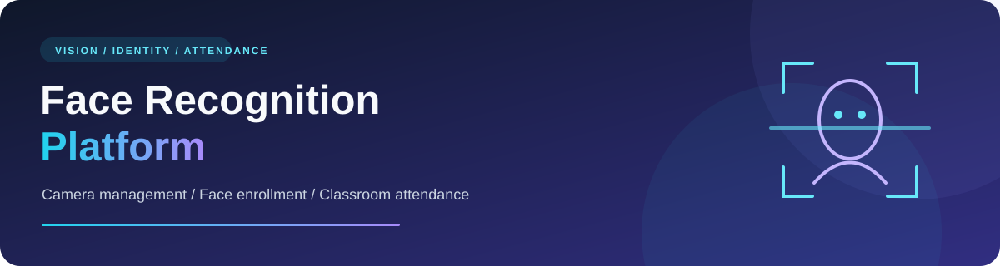
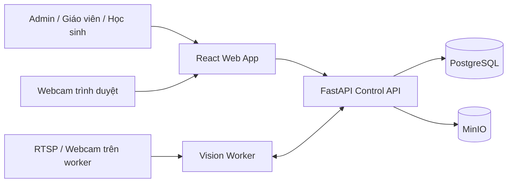

<p align="center">
  
</p>

<h1 align="center">📸 Face Recognition Platform</h1>

<p align="center"><strong>Quản lý camera · Đăng ký khuôn mặt · Điểm danh lớp học</strong></p>

<p align="center">
  
</p>

<p align="center">
  <a href="#cài-đặt-và-khởi-chạy">🚀 Cài đặt</a> ·
  <a href="#kiến-trúc">🧩 Kiến trúc</a> ·
  <a href="#quy-trình-sử-dụng">🎓 Sử dụng</a> ·
  <a href="./docs/security/role-based-attendance-operations.md">📚 Tài liệu vận hành</a>
</p>

---

Nền tảng quản lý camera, hồ sơ khuôn mặt và điểm danh lớp học, kết hợp giao diện React, API FastAPI và vision worker. Hệ thống hỗ trợ đăng ký ảnh, xét duyệt mẫu tham chiếu, quản lý lớp học và theo dõi kết quả nhận diện theo quyền người dùng.

<details>
<summary><strong>🧭 Mục lục — nhấn để mở</strong></summary>

- [Chức năng](#chức-năng)
- [Kiến trúc](#kiến-trúc)
- [Yêu cầu môi trường](#yêu-cầu-môi-trường)
- [Cài đặt và khởi chạy](#cài-đặt-và-khởi-chạy)
- [Chạy bằng CPU](#chạy-bằng-cpu)
- [Chạy bằng GPU NVIDIA](#chạy-bằng-gpu-nvidia)
- [FPS hiển thị và FPS suy luận](#fps-hiển-thị-và-fps-suy-luận)
- [Tạo tài khoản quản trị](#tạo-tài-khoản-quản-trị)
- [Quy trình sử dụng](#quy-trình-sử-dụng)
- [Cấu hình](#cấu-hình)
- [Model và nhận diện](#model-và-nhận-diện)
- [Kiểm tra mã nguồn](#kiểm-tra-mã-nguồn)
- [Cấu trúc thư mục](#cấu-trúc-thư-mục)
- [Xử lý lỗi thường gặp](#xử-lý-lỗi-thường-gặp)
- [Đưa dự án lên GitHub](#đưa-dự-án-lên-github)
- [Tài liệu và giấy phép](#tài-liệu-và-giấy-phép)

</details>

<a id="chức-năng"></a>

## ✨ Chức năng

- **Phân quyền:** Admin quản trị hệ thống, giáo viên quản lý lớp được giao, học sinh truy cập hồ sơ và kết quả của mình.
- **Quản lý lớp:** tài khoản, hồ sơ học sinh, danh sách lớp, phân công giáo viên và phiên điểm danh.
- **Đăng ký khuôn mặt:** gửi ảnh, xét duyệt mẫu và dùng ảnh đã duyệt làm dữ liệu tham chiếu.
- **Quản lý camera:** RTSP, webcam trên máy worker và webcam trình duyệt; giới hạn vùng theo dõi bằng ROI Polygon.
- **Giám sát:** xem camera, khung bao đối tượng và trạng thái xử lý tùy nguồn video, model và runtime được cấu hình.
- **Quản lý model:** lưu trữ, gán model và quản lý cấu hình xử lý.
- **Sự kiện và điểm danh:** xem lịch sử xác minh và ảnh bằng chứng theo quyền truy cập.
- **Lưu trữ riêng tư:** PostgreSQL lưu dữ liệu nghiệp vụ; MinIO lưu model, ảnh đăng ký và bằng chứng.

<a id="kiến-trúc"></a>

## 🧩 Kiến trúc



| Thành phần | Công nghệ / vai trò |
| --- | --- |
| Web | React, TypeScript, Vite |
| Control API | Python, FastAPI, Pydantic, Uvicorn |
| Vision worker | OpenCV, ONNX Runtime, GStreamer, tracking |
| Tìm kiếm vector | FAISS trong nhóm thư viện CPU |
| Database | PostgreSQL 17, migration SQL |
| Hạ tầng local | Docker Compose, Redis 7.4, MinIO |
| Kiểm tra | pytest, Ruff, mypy, Vitest, Testing Library |

API quản lý tài khoản, cấu hình và dữ liệu nghiệp vụ. Worker nhận cấu hình từ API bằng token nội bộ và xử lý nguồn camera. Webcam trình duyệt có luồng riêng trong ứng dụng; không cần chạy worker chỉ để khởi động web và API.

<a id="yêu-cầu-môi-trường"></a>

## 🛠️ Yêu cầu môi trường

Hướng dẫn nhanh sử dụng **Windows và PowerShell** với các script có sẵn.

| Công cụ | Yêu cầu theo cấu hình/script dự án |
| --- | --- |
| Python | 3.11 trở lên |
| Node.js | 20.19+ hoặc 22.12+ |
| npm | Có sẵn cùng Node.js |
| Docker Desktop | Đang chạy, có Docker Compose và Linux containers |
| Git | Clone và quản lý mã nguồn |
| GStreamer + Python GI bindings | Cần khi worker mở nguồn video thực tế |

Lần cài đầu cần mạng để tải thư viện, Docker images và model. Script cài nhóm phụ thuộc Python `.[dev,cpu]`; GPU không phải điều kiện để chạy hướng dẫn này.

<a id="cài-đặt-và-khởi-chạy"></a>

## 🚀 Cài đặt và khởi chạy

### 1. Lấy mã nguồn

Clone repository và mở PowerShell tại thư mục gốc:

```powershell
git clone https://github.com/JayC0603/Classroom-Face-Attendance.git
cd Classroom-Face-Attendance
```

Các lệnh bên dưới chạy từ thư mục này, nơi chứa `pyproject.toml` và `README.md`.

> [!TIP]
> Hình ảnh và tài liệu dùng đường dẫn tương đối, mở được trên GitHub hoặc sau khi clone. Trong VS Code, mở `README.md` và nhấn `Ctrl+Shift+V` để xem bản trình bày.

### 2. Cài thư viện và model khuôn mặt

```powershell
.\scripts\setup-local.ps1 -DownloadFaceModels
```

Script thực hiện:

1. Tạo `.env` với mật khẩu và khóa ngẫu nhiên nếu file chưa tồn tại.
2. Kiểm tra Python, Node.js và Docker Compose.
3. Tạo `.venv`, cài thư viện Python và chạy `npm ci` cho web.
4. Tải YuNet/SFace theo cấu hình đã ghim, kiểm tra SHA-256 và tải giấy phép model.

Script giữ nguyên `.env` đã có. Nếu file cũ thiếu biến bắt buộc hoặc còn giá trị mẫu, cần cập nhật trước khi chạy tiếp. Model tải về nằm trong `data/models/opencv-face/`.

Nếu đã cài thư viện và chỉ cần tải model:

```powershell
.\scripts\setup-local.ps1 -SkipInstall -DownloadFaceModels
```

### 3. Khởi động ứng dụng

```powershell
.\scripts\start-local.ps1
```

Script khởi động PostgreSQL, Redis, MinIO, tạo bucket riêng tư và mở các terminal API cùng web. Khi cấu hình PostgreSQL, API áp dụng migration trước khi tạo repository dữ liệu.

| Dịch vụ | Địa chỉ mặc định |
| --- | --- |
| Web | <http://127.0.0.1:5173> |
| API health | <http://127.0.0.1:8000/health> |
| API Swagger | <http://127.0.0.1:8000/docs> |
| MinIO API | `127.0.0.1:59000` |
| MinIO Console | <http://127.0.0.1:59001> |
| PostgreSQL | `127.0.0.1:55432` |
| Redis | `127.0.0.1:56379` |

Tài khoản MinIO nằm trong `.env`. Các cổng hạ tầng trong Compose chỉ bind vào loopback của máy local.

### 4. Chạy vision worker khi cần

Cài GStreamer, plugin giải mã CPU và Python GI bindings tương thích với Python của worker; xem [hướng dẫn local](./infrastructure/local/README.md). Sau đó chạy:

```powershell
.\scripts\run-worker.ps1
```

Hoặc khởi động toàn bộ cùng worker:

```powershell
.\scripts\start-local.ps1 -WithWorker
```

Có thể chạy từng thành phần trong các terminal riêng bằng `scripts/run-api.ps1`, `scripts/run-web.ps1` và `scripts/run-worker.ps1`.

### 5. Dừng ứng dụng

Dùng `Ctrl+C` trong các terminal API, web và worker, sau đó dừng hạ tầng:

```powershell
.\scripts\stop-local.ps1
```

> [!WARNING]
> Lệnh này giữ nguyên volume dữ liệu. Không dùng `docker compose down -v` nếu cần giữ dữ liệu PostgreSQL, Redis và MinIO.

<a id="chạy-bằng-cpu"></a>

## 🖥️ Chạy bằng CPU

Đây là cấu hình mặc định của script local, dùng được khi không có GPU NVIDIA. Có hai luồng xử lý riêng:

| Luồng | Model / runtime | Chạy ở đâu |
| --- | --- | --- |
| So sánh khuôn mặt đơn giản | YuNet + SFace, OpenCV DNN CPU | Control API |
| Pipeline worker | Model ONNX được tải và triển khai, ONNX Runtime CPU | Vision worker |

### Cài đặt và chạy

```powershell
.\scripts\setup-local.ps1 -DownloadFaceModels
.\scripts\start-local.ps1
```

Để dùng pipeline camera trên worker, cài GStreamer và GI bindings như phần khởi chạy, cấu hình model rồi chạy thêm:

```powershell
.\scripts\run-worker.ps1
```

Kiểm tra ONNX Runtime trong đúng môi trường Python:

```powershell
.\.venv\Scripts\python.exe -c "import onnxruntime as ort; print(ort.__version__); print(ort.get_available_providers())"
```

Danh sách cần có `CPUExecutionProvider`. Khi tạo deployment qua API, chọn `backend: "ONNX_CPU"`; manifest của phiên bản model phải khai báo tương thích. Giao diện triển khai tự động dùng `AUTO`; nút triển khai nhanh model người hiện tạo deployment CPU.

Trong **Cameras → chỉnh sửa camera**, có thể bắt đầu với `display_fps = 15`, `sampling_fps = 5`, lưu và kích hoạt camera. Đây là giá trị cấu hình thử ban đầu, không phải kết quả benchmark. Nếu CPU quá tải, giảm sampling hoặc độ phân giải, dùng model nhẹ hơn và kiểm tra số camera chạy đồng thời.

<a id="chạy-bằng-gpu-nvidia"></a>

## 🎮 Chạy bằng GPU NVIDIA

**Trạng thái hiện tại: worker production chỉ bật `ONNX_CPU`.** Resolver có các chế độ `ONNX_CUDA`, `TENSORRT`, `AUTO`, và lớp ONNX session đã nhận CUDA provider, nhưng `ProductionAdapterFactory.supported_backends` trong [model_delivery.py](./workers/vision-worker/src/vision_worker/model_delivery.py) chỉ khai báo CPU. Máy có GPU vẫn chạy CPU với factory này; yêu cầu `ONNX_CUDA` tường minh sẽ bị từ chối với `ADAPTER_UNAVAILABLE`.

Luồng YuNet/SFace của Control API đang dùng `DNN_BACKEND_OPENCV` và `DNN_TARGET_CPU`; cài ONNX Runtime GPU **không chuyển luồng này sang GPU**. FAISS trong nhóm thư viện hiện tại cũng là bản CPU. Các bước dưới đây dành cho chuẩn bị môi trường và xác định phần cần hoàn thiện, chưa phải cấu hình GPU production đã được xác nhận hoạt động.

### 1. Chuẩn bị máy

- GPU NVIDIA hỗ trợ CUDA và driver phù hợp.
- CUDA, cuDNN và thư viện hệ thống tương thích với **phiên bản ONNX Runtime GPU đã chọn**; trên Windows cần DLL được tìm thấy qua môi trường chạy.
- Model ONNX và manifest có khai báo `ONNX_CUDA` trong `runtime_compatibility`.
- GStreamer và GI bindings nếu worker mở RTSP hoặc webcam trên máy worker.

Đối chiếu [bảng tương thích CUDA/cuDNN chính thức của ONNX Runtime](https://onnxruntime.ai/docs/execution-providers/CUDA-ExecutionProvider.html#requirements) trước khi cài. Không dùng một bộ phiên bản CUDA/cuDNN cho mọi bản ONNX Runtime.

### 2. Cài môi trường GPU

Chạy setup trước để tạo `.env`, môi trường và thư viện chung. Sau đó dừng API/worker đang chạy và thay gói ONNX Runtime trong `.venv`:

```powershell
.\scripts\setup-local.ps1 -DownloadFaceModels
.\.venv\Scripts\python.exe -m pip uninstall -y onnxruntime onnxruntime-gpu
.\.venv\Scripts\python.exe -m pip install "onnxruntime-gpu>=1.20,<2"
.\.venv\Scripts\python.exe -c "import onnxruntime as ort; print(ort.__version__); print(ort.get_available_providers())"
```

Lệnh cài GPU trên sử dụng khoảng phiên bản tương ứng với dependency CPU của repo. Khi đã chọn bộ CUDA/cuDNN, ghim phiên bản cụ thể phù hợp thay cho khoảng phiên bản này để tái lập môi trường. Không cài đồng thời `onnxruntime` và `onnxruntime-gpu` vì chúng cung cấp cùng module Python. Chạy lại setup có cài `.[dev,cpu]` sẽ cài lại bản CPU; cần thực hiện lại bước chuyển GPU sau đó.

Danh sách provider cần có `CUDAExecutionProvider`. Đây mới là kiểm tra package/provider được công bố; phải triển khai và chạy model thật để xác nhận GPU hoạt động.

### 3. Chạy trên máy có GPU và kiểm tra runtime

```powershell
.\scripts\start-local.ps1
.\scripts\run-worker.ps1
```

Với mã nguồn hiện tại, dùng deployment CPU để chạy ứng dụng trên máy có GPU. `AUTO` cũng bị giới hạn bởi adapter CPU của factory; không coi `ACTIVE` của deployment tự động là bằng chứng GPU đã được sử dụng.

Để hoàn thiện GPU worker, cần mở hỗ trợ CUDA trong production factory, kiểm tra manifest theo backend được resolve, kiểm thử khởi tạo/warmup/lỗi provider và so sánh kết quả với CPU trên model thật. Sau khi có phần triển khai đó, quy trình API dự kiến dùng tài khoản admin đã xác thực tại `/docs` là:

1. `POST /api/v1/model-versions/{version_id}/deployments`, body `{"backend":"ONNX_CUDA","precision":"FP32"}`.
2. `POST /api/v1/deployments/{deployment_id}/activate` để worker nhận yêu cầu, tải model và warmup.
3. Chờ deployment `ACTIVE`, rồi gán qua nút **Dùng cho nhận diện** hoặc `PUT /api/v1/model-assignments` với `model_type` và `deployment_id`.
4. Xem `GET /api/v1/deployments/{deployment_id}/runtime` và trạng thái runtime camera để kiểm tra backend/provider thực tế, lỗi hoặc lý do fallback.

Quy trình CUDA trên sẽ chưa kích hoạt thành công với factory CPU hiện tại. `ONNX_CUDA` là yêu cầu tường minh: thiếu adapter, CUDA hoặc artifact tương thích phải báo lỗi. `AUTO` chỉ chọn trong các backend adapter hỗ trợ; luôn đọc backend thực tế. TensorRT còn phụ thuộc adapter và engine tương thích, không được bật chỉ bằng lệnh cài `onnxruntime-gpu`.

Khi có runtime GPU đã kiểm chứng, mới tăng dần `sampling_fps` theo số đo thực tế. Tăng `display_fps` chỉ thay đổi mục tiêu truyền/xem hình; không chứng minh tốc độ nhận diện tăng. GPU chưa được benchmark trong lần cập nhật này.

### Quay lại CPU

Dừng API/worker, thay package và triển khai lại model bằng `ONNX_CPU`:

```powershell
.\.venv\Scripts\python.exe -m pip uninstall -y onnxruntime-gpu onnxruntime
.\.venv\Scripts\python.exe -m pip install "onnxruntime>=1.20,<2"
```

<a id="fps-hiển-thị-và-fps-suy-luận"></a>

## ⏱️ FPS hiển thị và FPS suy luận

Hệ thống không có một giá trị FPS chung cho mọi bước:

| Thông số | Ý nghĩa | Giới hạn / mặc định |
| --- | --- | --- |
| FPS nguồn | Nhịp camera hoặc video gốc | Phụ thuộc thiết bị và cấu hình nguồn |
| `display_fps` | Mục tiêu upload webcam trình duyệt hoặc xuất preview worker | Mặc định 15; giao diện 1–30 |
| `sampling_fps` | Mục tiêu lấy mẫu suy luận worker; nhịp yêu cầu của ô nhận diện trên web | Mặc định 5; giao diện 1–30; API chấp nhận >0 đến 60 |
| `--processing-fps` / `-ProcessingFps` | Trần suy luận bổ sung khi chạy worker | Không truyền thì dùng sampling của từng camera |
| `input_fps` | Số frame đầu vào mà runtime báo cáo nhận được mỗi giây | Số đo, không phải cấu hình |
| `processed_fps` | Số frame đã qua xử lý của runtime mỗi giây | Số đo, không phải FPS hiển thị hoặc số lần xác minh danh tính |

`input_fps` và `processed_fps` của pipeline là trung bình từ khi runtime khởi động; cần chờ đủ thời gian để đánh giá. Khi worker chỉ thu hình và chưa có detector, `processed_fps` có thể bằng 0 dù vẫn có preview. Luồng so sánh OpenCV tại API không được đo bằng FPS suy luận của worker.

### Vì sao trước đây thường chỉ khoảng 4 FPS?

Trước khi cập nhật, ô nhận diện chờ thêm **200 ms sau khi API trả lời**; chế độ compact chờ 500 ms. Với thời gian API khoảng 50 ms, chu kỳ là `200 + 50 = 250 ms`, tương đương khoảng 4 FPS. Đây là ví dụ giải thích nhịp polling, chưa phải phép đo trên máy của bạn. Script worker đồng thời truyền cố định `--processing-fps 5`, nên tăng sampling camera vẫn không vượt trần này.

Bản hiện tại dùng nhịp theo cấu hình và trừ thời gian yêu cầu đã chạy:

- Webcam trình duyệt truyền hình theo `display_fps`, độc lập với sampling worker; bỏ trần upload cũ 10 FPS.
- Preview worker được web lấy theo `display_fps`, thay cho nhịp cố định 200 ms.
- Ô nhận diện lấy ảnh và kết quả tương ứng theo `sampling_fps`; chế độ compact dùng cùng cấu hình này.
- Script worker mặc định dùng sampling của từng camera; chỉ áp trần bổ sung khi truyền `-ProcessingFps`.

Các yêu cầu vẫn tuần tự để không xếp hàng frame hoặc chồng yêu cầu. Nếu xử lý một yêu cầu mất 250 ms thì tốc độ thực vẫn quanh 4 FPS, kể cả khi cấu hình 30. Ảnh trong **ô nhận diện có khung bao** đi cùng kết quả xử lý nên vẫn phụ thuộc nhịp nhận diện và thời gian API; `display_fps = 30` không biến ô này thành video 30 FPS. Monitor OpenCV nền cũng có nhịp chờ riêng 200 ms giữa các lượt xử lý.

### Cách chỉnh FPS

1. Mở **Cameras → chỉnh sửa camera**.
2. Đặt riêng **FPS hiển thị** và **FPS suy luận (sampling)**. Ví dụ: hiển thị 15, suy luận 5.
3. Lưu cấu hình, kích hoạt camera và kiểm tra revision/runtime đã áp dụng. Webcam trình duyệt cần bắt đầu realtime lại nếu thay đổi cấu hình làm session dừng.
4. Chạy worker theo cấu hình camera:

   ```powershell
   .\scripts\run-worker.ps1
   ```

   Nếu cần giới hạn toàn worker để giảm tải:

   ```powershell
   .\scripts\run-worker.ps1 -ProcessingFps 10
   ```

Với camera đồng bộ từ API, mục tiêu worker là `min(sampling_fps, ProcessingFps)` nếu có truyền trần. Ví dụ camera sampling 5 vẫn xử lý tối đa mục tiêu 5 dù trần worker là 10. Chế độ CLI dùng `--camera-config` riêng vẫn có mặc định 5 khi không truyền `--processing-fps`.

### Kiểm tra khi vẫn chậm

- Phân biệt video webcam gốc, ảnh preview, ô nhận diện và `processed_fps` trước khi so sánh.
- Xem Network trong DevTools: thời gian `/recognition`, upload frame và preview; kiểm tra request có bị giới hạn bởi mạng hoặc API.
- Kiểm tra sampling camera, tham số worker, provider thực tế và model đã `ACTIVE`.
- Xem frame bị bỏ, bộ đệm, số camera đồng thời và tải CPU/GPU. Luồng quá tải ưu tiên frame mới thay vì giữ hàng đợi dài.
- Đo cùng nguồn, độ phân giải, model và thời gian chạy khi so CPU/GPU; ghi lại FPS thực tế thay vì coi FPS cấu hình là hiệu năng đạt được.

<a id="tạo-tài-khoản-quản-trị"></a>

## 🔑 Tạo tài khoản quản trị

Không có tài khoản hoặc mật khẩu admin mặc định. Sau khi PostgreSQL khởi động, mở PowerShell tại thư mục gốc và chạy:

```powershell
.\.venv\Scripts\python.exe -c "from dotenv import load_dotenv; load_dotenv('.env'); from control_api.auth_cli import main; raise SystemExit(main())"
```

Lệnh nạp `.env` vào tiến trình CLI, sau đó yêu cầu email, mật khẩu tối thiểu 12 ký tự và xác nhận mật khẩu. `python-dotenv` được cài cùng `uvicorn[standard]`.

Nếu đã đặt `FR_POSTGRES_DSN` trong biến môi trường của terminal, có thể dùng trực tiếp:

```powershell
.\.venv\Scripts\python.exe -m control_api.auth_cli
```

Đăng nhập trên web bằng tài khoản vừa tạo. CLI khởi tạo quản trị viên đầu tiên; các tài khoản tiếp theo được quản lý trong ứng dụng theo quyền.

<a id="quy-trình-sử-dụng"></a>

## 🎓 Quy trình sử dụng

1. **Admin:** tạo hồ sơ Person cho học sinh, tạo tài khoản học sinh và liên kết đúng Person.
2. **Admin:** tạo giáo viên, lớp học, phân công giáo viên và thêm học sinh vào danh sách lớp.
3. **Học sinh:** gửi ảnh khuôn mặt từ hồ sơ cá nhân.
4. **Giáo viên hoặc admin:** kiểm tra và duyệt ảnh. Ảnh chờ duyệt hoặc bị từ chối không được dùng làm mẫu so sánh.
5. **Admin:** thêm camera, chọn nguồn video, thiết lập ROI và model phù hợp.
6. **Giáo viên:** tạo phiên điểm danh cho lớp và camera được phép sử dụng, theo dõi kết quả.
7. **Người dùng:** xem lịch sử, điểm danh và bằng chứng trong phạm vi quyền truy cập.

Không có quan sát đã xác minh chưa đủ để kết luận học sinh vắng mặt; cần xem xét tình trạng camera và mức độ bao phủ của hệ thống.

<a id="cấu-hình"></a>

## ⚙️ Cấu hình

`.env` tại thư mục gốc là cấu hình riêng của máy; không đưa lên GitHub.

| Biến / nhóm biến | Mục đích |
| --- | --- |
| `POSTGRES_*` | Database, tài khoản, mật khẩu và cổng PostgreSQL local |
| `FR_POSTGRES_DSN` | Chuỗi kết nối PostgreSQL của API và CLI |
| `FR_CAMERA_ENCRYPTION_KEY` | Khóa mã hóa cấu hình camera nhạy cảm |
| `FR_WORKER_INTERNAL_TOKEN` | Xác thực nội bộ giữa worker và API |
| `FR_AUTH_RATE_LIMIT_KEY` | Khóa giới hạn đăng nhập, tối thiểu 32 ký tự; giữ ổn định qua restart |
| `REDIS_URL` | Địa chỉ Redis local |
| `MINIO_ROOT_USER`, `MINIO_ROOT_PASSWORD` | Tài khoản quản trị MinIO local |
| `MINIO_ENDPOINT`, `MINIO_ACCESS_KEY`, `MINIO_SECRET_KEY` | Kết nối MinIO của backend |
| `MINIO_MODELS_BUCKET` | Bucket model, mặc định `models` |
| `MINIO_FACE_IMAGES_BUCKET` | Bucket ảnh đăng ký, mặc định `face-images` |
| `MINIO_EVIDENCE_BUCKET` | Bucket bằng chứng, mặc định `evidence` |
| `FR_MODEL_ARTIFACT_ROOT`, `FR_FACE_IMAGE_ROOT`, `EVIDENCE_ROOT` | Đường dẫn dữ liệu local |

Các cấu hình bổ sung:

- [Pipeline mẫu](./configuration/examples/face-recognition.example.json).
- [Camera mẫu](./configuration/examples/camera.example.json).
- [YuNet/SFace](./configuration/models/opencv-face.json).
- [Biến hạ tầng mẫu](./infrastructure/local/.env.example): chỉ dành cho phát triển, không thay thế `.env` riêng do setup tạo.

Để đổi API đích của Vite khi phát triển, đặt `FR_DEV_API_URL` trong `apps/web/.env.local`. Mặc định web proxy `/api` và `/health` tới `http://127.0.0.1:8000`.

<a id="model-và-nhận-diện"></a>

## 🧠 Model và nhận diện

Luồng so sánh OpenCV dùng **YuNet** để phát hiện mặt và **SFace** để tạo đặc trưng so sánh với ảnh tham chiếu đã duyệt. Chưa có ảnh tham chiếu vẫn có thể phát hiện và vẽ khung mặt, nhưng chưa thể xác minh danh tính từ bộ ảnh đăng ký.

**YOLOX**, **SCRFD**, **AdaFace**, tracking và tìm kiếm vector thuộc pipeline worker, phụ thuộc model, manifest và cấu hình được gán. Người vận hành cung cấp model tương ứng. Lệnh tải YuNet/SFace không cài đầy đủ model của pipeline worker; xem [model manifests](./model-manifests/examples/README.md).

Repo không chứa sẵn model người dùng, URL camera thật hoặc bộ dữ liệu khuôn mặt. Hiệu năng và độ chính xác phụ thuộc thiết bị, model, ánh sáng, góc mặt, sampling FPS và dữ liệu tham chiếu. Test phần mềm không thay thế đánh giá model trên dữ liệu thực tế được phép sử dụng.

Session webcam trình duyệt hiện cần API chạy một tiến trình. Việc tăng số API worker cần cơ chế chia sẻ trạng thái session phù hợp.

<a id="kiểm-tra-mã-nguồn"></a>

## 🧪 Kiểm tra mã nguồn

Sau khi chạy setup:

```powershell
.\scripts\verify-local.ps1
```

Script chạy pytest, Ruff, mypy, web typecheck, Vitest và production build. Có thể chạy riêng:

```powershell
.\.venv\Scripts\python.exe -m pytest --basetemp .test-tmp -p no:cacheprovider
.\.venv\Scripts\python.exe -m ruff check .
.\.venv\Scripts\python.exe -m mypy apps/control-api/src workers/vision-worker/src packages/python
npm --prefix apps/web run typecheck
npm --prefix apps/web run test -- --pool=threads --maxWorkers=1
npm --prefix apps/web run build
```

Các bài kiểm tra PostgreSQL/MinIO cần dịch vụ kiểm thử riêng và có thể được bỏ qua khi chưa cấu hình. Xem [integration tests](./tests/integration/README.md), [end-to-end tests](./tests/end-to-end/README.md) và [performance tests](./tests/performance/README.md). Dùng database và bucket tách khỏi dữ liệu đang sử dụng.

<a id="cấu-trúc-thư-mục"></a>

## 🗂️ Cấu trúc thư mục

```text
.
├── apps/
│   ├── control-api/          # FastAPI, xác thực, camera, hồ sơ và điểm danh
│   └── web/                  # React + TypeScript
├── workers/
│   └── vision-worker/        # Nhận cấu hình, đọc video và xử lý pipeline
├── packages/
│   ├── python/               # Domain, cấu hình và contracts dùng chung
│   └── contracts/            # OpenAPI và JSON Schema
├── configuration/            # Cấu hình mẫu và thông tin model
├── model-manifests/          # Manifest model mẫu
├── infrastructure/
│   ├── local/                # Docker Compose và khởi tạo bucket
│   └── database/             # Migration SQL
├── scripts/                  # Setup, chạy ứng dụng, tải model và kiểm tra
├── tests/                    # Unit, contract, integration, E2E và performance
├── docs/                     # Thiết kế, vận hành và bằng chứng nghiệm thu
├── pyproject.toml            # Phụ thuộc và công cụ Python
└── README.md
```

`.env`, `.venv/`, `data/`, `node_modules/` và các thư mục build/cache được tạo trên máy phát triển và được Git bỏ qua.

<a id="xử-lý-lỗi-thường-gặp"></a>

## 🩺 Xử lý lỗi thường gặp

| Hiện tượng | Cách kiểm tra / xử lý |
| --- | --- |
| PowerShell chặn script | Nếu chính sách máy cho phép, chạy `Set-ExecutionPolicy -Scope Process -ExecutionPolicy Bypass` rồi chạy lại script; chỉ áp dụng trong terminal hiện tại. |
| Không kết nối Docker | Mở Docker Desktop, đợi engine sẵn sàng và kiểm tra `docker compose version`. |
| Dịch vụ chưa healthy | Chạy `docker compose --env-file .env -f infrastructure/local/compose.yaml ps` và xem `logs` của dịch vụ lỗi. |
| Cổng bị sử dụng | Kiểm tra tiến trình chiếm cổng; nếu đổi cổng, cập nhật đồng bộ cấu hình kết nối và script liên quan. |
| CLI thiếu `FR_POSTGRES_DSN` | Dùng lệnh tạo admin có `load_dotenv` ở trên; CLI trực tiếp không tự đọc `.env`. |
| PostgreSQL từ chối mật khẩu | Kiểm tra `.env` có khớp thông tin khi volume database được tạo; đổi `.env` không tự đổi mật khẩu trong database cũ. |
| Worker thiếu `gi` hoặc GStreamer | Cài bindings và plugin tương thích với Python worker; thư viện pip của dự án không cài toàn bộ phụ thuộc hệ thống này. |
| Webcam trình duyệt không mở | Kiểm tra quyền camera và ứng dụng đang giữ camera; khi truy cập từ xa cần secure context phù hợp. |
| Có khung mặt nhưng không có danh tính | Kiểm tra model đã tải, ảnh tham chiếu đã duyệt và liên kết đúng hồ sơ. |
| Model tải lỗi hoặc sai checksum | Kiểm tra mạng, chạy lại lệnh tải; giữ nguyên bước xác minh SHA-256. |

<a id="đưa-dự-án-lên-github"></a>

## 📦 Đưa dự án lên GitHub

Trước khi commit, chạy bộ kiểm tra và xem thay đổi:

```powershell
.\scripts\verify-local.ps1
git status --short
git diff --check
```

Không commit `.env`, `apps/web/.env.local`, `data/`, model người dùng, ảnh khuôn mặt, embedding, log, token hoặc URL RTSP chứa mật khẩu. `.gitignore` không loại bỏ file đã được Git theo dõi trước đó; cần kiểm tra nội dung được stage.

Chọn rõ các file muốn đưa lên. Nếu chỉ cập nhật tài liệu:

```powershell
git add README.md
git diff --cached --stat
git diff --cached
git commit -m "docs: complete project README"
```

Nếu repo đã có remote và nhánh upstream:

```powershell
git push
```

Nếu chưa có remote, tạo repository trống trên GitHub rồi thay `YOUR_USERNAME`, `YOUR_REPOSITORY` và `YOUR_BRANCH` bằng giá trị thật. Dùng `git branch --show-current` để xem nhánh hiện tại.

```powershell
git remote add origin https://github.com/YOUR_USERNAME/YOUR_REPOSITORY.git
git push -u origin YOUR_BRANCH
```

<a id="tài-liệu-và-giấy-phép"></a>

## 📚 Tài liệu và giấy phép

- [Hạ tầng local, backup và restore](./infrastructure/local/README.md).
- [Vận hành, phân quyền và dữ liệu riêng tư](./docs/security/role-based-attendance-operations.md).
- [Ma trận quyền API](./docs/security/role-route-matrix.md).
- [Nghiệm thu PostgreSQL, MinIO, Person và Model](./docs/acceptance/postgres-minio-person-model.md).
- [Bằng chứng so sánh YuNet/SFace](./docs/acceptance/2026-10-19-opencv-face-comparison.md).
- [Hướng dẫn model manifests](./model-manifests/examples/README.md).

Khi triển khai dữ liệu thật, sử dụng HTTPS, bảo vệ khóa bí mật, giới hạn truy cập hạ tầng và thiết lập chính sách lưu trữ ảnh. Sao lưu PostgreSQL cùng ba bucket `models`, `face-images`, `evidence` tại cùng thời điểm theo hướng dẫn vận hành.

Repository hiện chưa có file `LICENSE`. Nếu muốn phát hành theo giấy phép cụ thể, cần bổ sung giấy phép phù hợp. Thư viện và trọng số model có điều khoản riêng; script tải model lưu giấy phép tương ứng cạnh file model.
